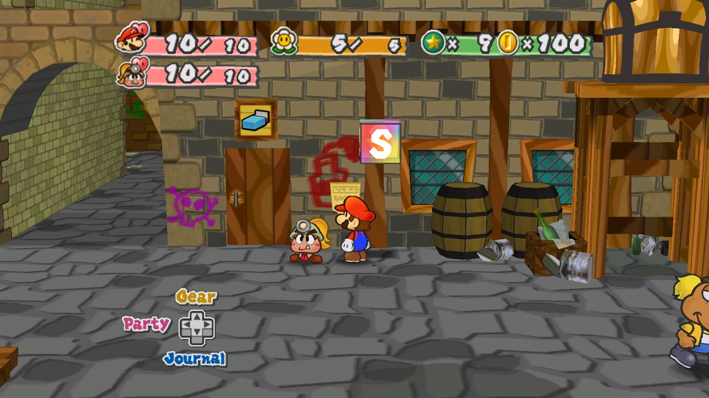
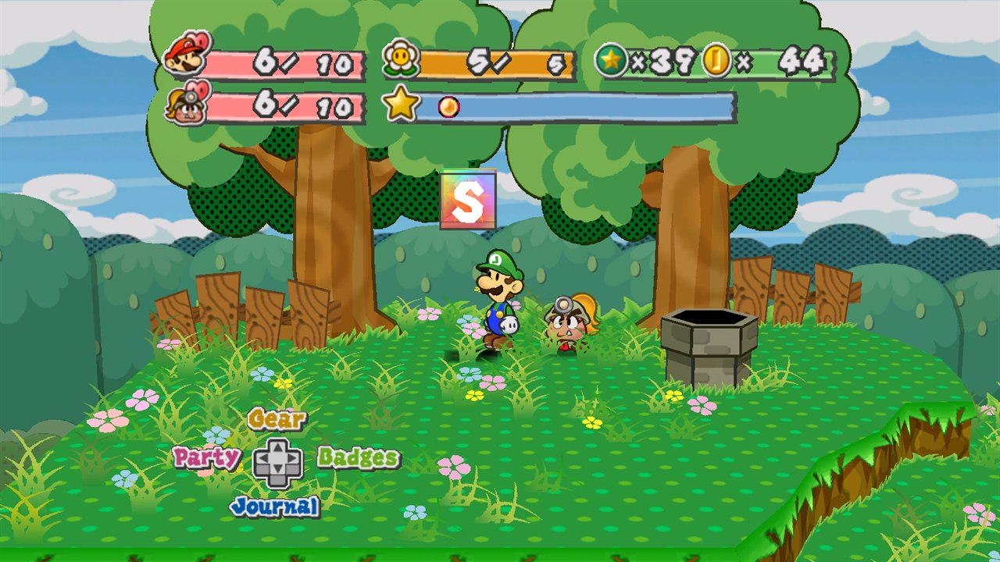
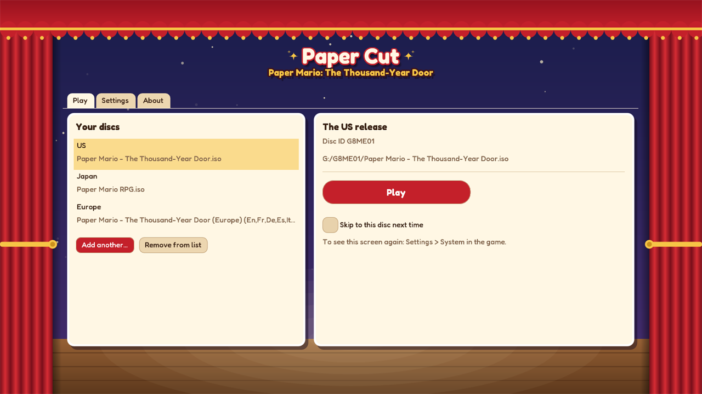
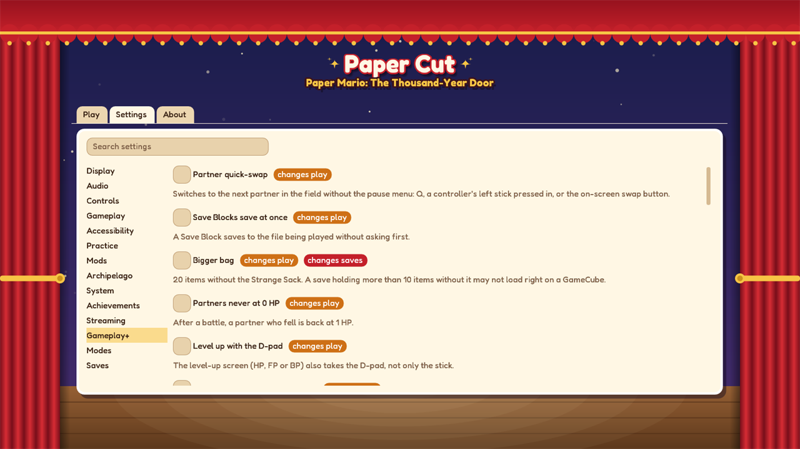
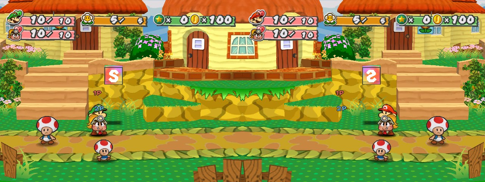
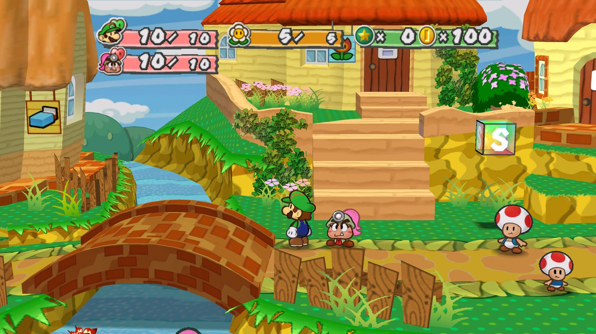
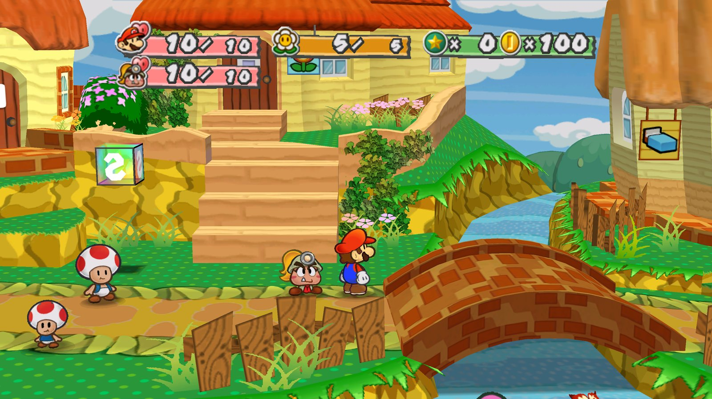
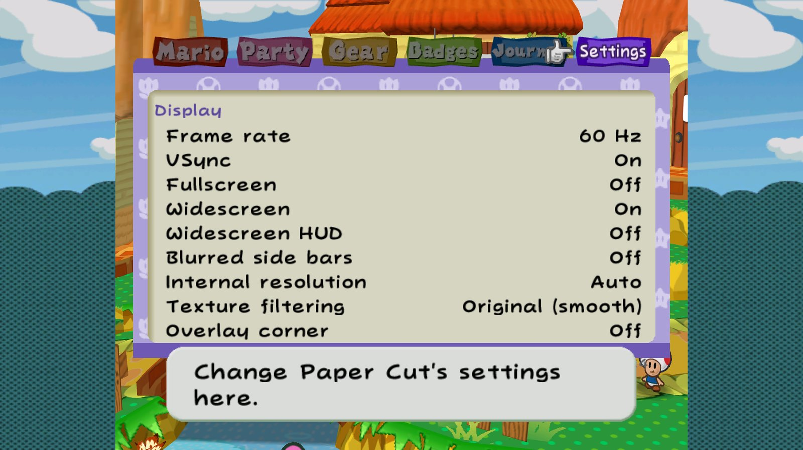
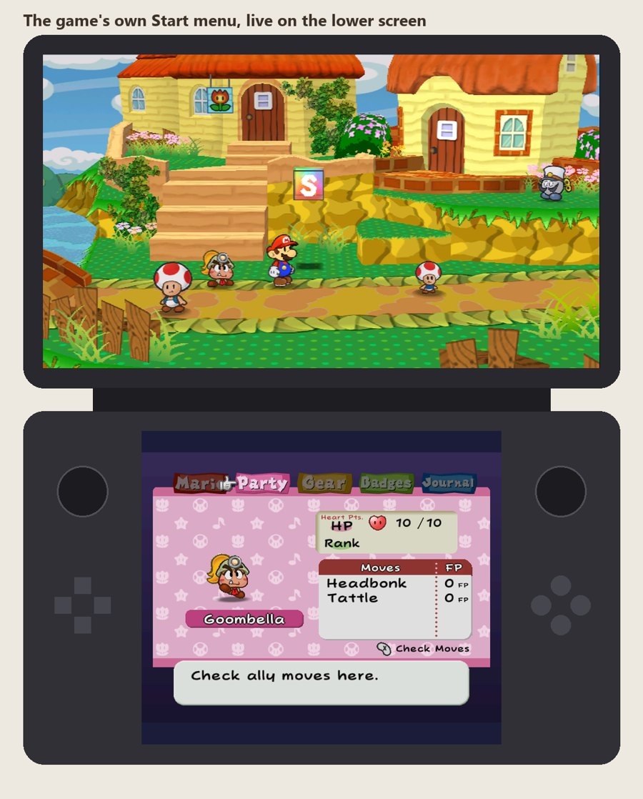

<p align="center"></p>

**A native port of Paper Mario: The Thousand-Year Door.** Paper Cut plays the Japanese (G8MJ01), US (G8ME01) and European (G8MP01) releases on Windows, macOS, Linux, iOS and Android, 64-bit, with no emulator.

The game code is C, from the decompilation in [LLCOOLT/ttyd](https://github.com/LLCOOLT/ttyd). The GameCube platform under it (graphics, audio, input, disc, memory card) is replaced, through [Aurora](https://github.com/encounter/aurora) (WebGPU/Dawn and SDL3).

**No game data is included.** You need your own copy of the game: Paper Cut runs from your disc image.

**Download:** packages are on the [Releases](https://github.com/LLCOOLT/paper-cut/releases) page. One download per platform plays every version: `papercut-<version>-<platform>.zip` (iPhone and Android: `papercut-<version>-<us|jp|eu>-...`, since a phone app can only run its own code). To build it yourself, see [Building and running](#building-and-running).

<p align="center">
  
  
  
  
</p>

<p align="center">
  
  
  
  
  
  
  
</p>

## Getting started

Start **Paper Cut** and add your disc image (.iso, .rvz, .gcm...) to the launcher's library. Paper Cut recognises which release it is and plays it. The launcher works with a mouse, a keyboard, a controller or touch. It also holds the settings, so you can set things up before the game starts. With "Skip to this disc next time" turned on, the next start goes straight to the game.

**Playing with a keyboard:**

| Keys | Do |
|---|---|
| WASD or the arrows | move (the stick) |
| Space | A |
| E | B |
| R | X |
| F | Y |
| Q | Z |
| 1 / 3 | L / R |
| Enter | Start |

Change any of them under Settings > Controls > Keyboard keys. The port's own keys:
- F1: settings.
- F5 / F8: save / load state.
- F6 / F7: frame advance.
- Tab: fast-forward.
- F11: fullscreen.
- F12: screenshot.

## Features

**Co-op, at home and online**
- **A second player plays the partner:** in battle its moves, action commands and guards; in the field it walks anywhere with its own stick, hops, talks to people, hits blocks, uses its ability and switches partners. Mario calls it back with Y. "1P" and "2P" over the characters show who's who.
- **Joining:** with co-op on, A on another controller joins as player 2. The Players section (Controls) shows who is who, and picks player 2's controller by a press; a keyboard and one pad are enough.
- **Online co-op:** the launcher's Online tab. The host waits and shares their address; the other player joins with it. Both need Paper Cut and their own disc of the same release, and any platform plays with any other (Windows, Mac, Linux, iPhone, Android). Both games run in lockstep: only the controllers' input crosses the network, each frame, and the games check every second that they're still the same. The guest plays on the host's save and settings for the session, with their own display, sound and controls; their own saves aren't touched.

**Playing online, step by step**
1. Both players: the same Paper Cut version, and a disc of the same release (both US, both JP or both EU) in the launcher's library.
2. The host: the launcher's **Online** tab, **Host a game** (port 47700 unless you change it), then **Host**. The tab shows your address; send it to the other player.
3. The other player: **Join a game**, the host's address, then **Join**.
4. The host: **Start from the title** or **Continue where you left off**, then **Start**. Both games start together.

On the same home network, the address shown works as it is. Over the internet, the host forwards the port (TCP 47700) on their router to their computer, or both players join the same [Tailscale](https://tailscale.com) or [ZeroTier](https://www.zerotier.com) network and use its address. Save states, fast-forward, frame advance, warps and the Practice tab's editors are off while playing online, so both games stay the same.

**A second screen** on dual-screen handhelds like the AYN Thor (Android): the game's own Start menu, live on the lower screen while you play on the upper one, navigated by touch. Using an item or switching partners from it works as in the menu. It's only there on devices with a second built-in screen.

**Saves and languages**
- **Saves:** memory card saves are Dolphin's `.gci` files. They're backed up automatically and can be converted between versions.
- **Quick resume:** Continue in the launcher picks up where you left off, even if the app was closed without saving.
- **Languages:** the European version plays in English, German, French, Spanish or Italian, and any version can show the text of another disc you own.

**Settings:** the Start menu's Settings tab, after the Journal: every on/off, choice and number, changed where it is, and All settings for the rest. The full page also opens with F1, a controller's Back/Select, the three-bar button on the touch controls, or a three-finger tap. Tabs down the side, a search box, and a mark on every setting that changes how the game plays or what it saves. A setting that applies from the next start has Restart now beside it: the game starts again and puts you back where you were.

**Display**
- **120 Hz and up:** extra frames are drawn between the game's 60 Hz ones, with interpolated camera, characters and animation. The game's logic is untouched.
- **Any shape of screen:** 4:3, 16:9, 16:10, 21:9 and 32:9, with the HUD sized from 50% to 150%.
- Internal resolution of 1–8× with supersampling, anisotropic filtering, sharp text, and CRT, paper-grain and sharpen filters.
- **Texture upscaling:** the game's textures made 2× or 4× larger by Paper Cut's own edge-following filter, for smoother lines on paper, signs and walls.
- MSAA, texture detail, blurred letterbox bars on wide screens, and 50 or 60 Hz for the European version.
- Variable refresh rate, and a performance overlay with frame times, 1% lows and jitter.
- **The window:** it opens where you left it, at its size, and never off the screen or larger than it. It sizes to 1x-4x the picture or to the picture's shape, can stay above other windows, and goes full screen with F11 or Alt+Enter.
- **Free camera:** the right stick turns the camera a little around Mario and moves it in or out, easing back when let go.
- **Mirror mode:** the world flipped left to right, with the controls turned to match; menus and text stay readable.
- **Cosmetics:** Mario's cap and overalls, Goombella's hair, Vivian and the HUD's bars in 13 colours or any from a picker, with Luigi, Wario, Waluigi and Fire Mario presets, recoloured with their shading kept.

**Gameplay+** (each option off by default):
- Partner quick-swap, faster menus and text, skipped repeated scenes, Save Blocks without the question, and item storage at any Save Block.
- A bigger bag, badge loadouts, a walk-speed boost, and coin and Star Point multipliers.
- Retry on Game Over, fast travel, a journal of collectibles, a Star Piece and Shine Sprite tracker, a jukebox, and Tattle without spending a turn.
- Battle pop-ups, Pit of 100 Trials and Glitz Pit tweaks, a remake-style balance, and New Game+.
- **Play as Luigi:** Luigi in Mario's place, with 156 animations of his own made for Paper Cut. The brothers swap everywhere: Mario stands in Luigi's place in the story's scenes, and the text, menus and credits follow.

**Accessibility:** a difficulty slider (enemy HP and attack), action-command assist (wider timing, or automatic), larger message windows (up to 150%), and "Where next?" hints: Y on the Journal tab names where the story goes next, and nothing is shown until you ask.

**Challenges:** presets in one click (Hard, Expert, Glass cannon, Superguards only, One hit), and rules to mix: one-hit KO, no guarding, harder attack commands, no items in battle.

**Practice:** a speedrun timer with load removal and [LiveSplit](https://livesplit.org) support, frame advance, RNG control, stat, item and story-flag editors, a memory watch, an input display (sticks, buttons and triggers in a corner), and ten labelled save-state slots (F5 saves, F8 loads). Plus 25 achievements read from your save, which don't count while the practice tools are on.

**Everyday:** autosave when you go into another room (off by default), fast-forward (Tab), adjustable text speed, screenshots (F12), controller rumble, and a check for new releases on start. Saves are backed up automatically and kept in step across devices: in iCloud on Apple devices, and on Windows and Linux through any folder a sync service keeps (OneDrive, Dropbox, Google Drive, Syncthing, or iCloud for Windows). If the game crashes, a report is written for you to send.

**Audio and controls:**
- **Audio:** one mixer for the master, music, effects and ambience volumes, each with a mute button, and volume keys anywhere (F9 quieter, F10 louder, F3 mute).
- **Music shuffle and your own music:** each room's music another of the game's tracks, field for field and battle for battle; or your own OGG, MP3, FLAC or WAV files in the `music` folder, named after the track they replace (`tracks.txt` there lists them), looping at their loop tags.
- **Controls:** the mouse works in the game's menus, lists and battle commands. Keys and every player's controller buttons can be remapped.
- **Controllers:** Xbox, PlayStation, Switch (Pro and Joy-Con), Steam Deck, GameCube through an adapter, MFi, and about 2,300 other models from the community mapping list, named as you know them. Choose which is player 1-4, test them, and set dead zones and trigger points. A controller nothing recognises is set up by pressing its buttons when asked.
- **Button prompts:** the game's button pictures, and the remapping list's names, match your Xbox, PlayStation, Switch or Steam Deck controller, or your keys.
- **Menus in six languages:** the settings page and the Start menu's Settings tab in English, Deutsch, Français, Español, Italiano or Japanese (System > Menu language; Auto follows the disc or the computer).

**Mods:** a mod manager on the settings page. Mods replace or add disc files, textures and text (Dolphin texture packs work as they are), change game data, run scripts and code through hooks generated from the decompilation, and GameCube code mods can be ported from their source. Also in this area:
- [Archipelago](https://archipelago.gg) multiworld seeds (US).
- A built-in item randomizer: a seed and what to shuffle on the settings page, no server needed, with a spoiler log (US).
- Audience effects from chat.
- A boss rush, boss refights and an endless Glitz Pit.
- Characters exported from the game (model, animations, textures), edited in Blender and put back as a mod.

See [docs/MODDING.md](docs/MODDING.md), [docs/MODES.md](docs/MODES.md) and [docs/RANDOMIZER.md](docs/RANDOMIZER.md).

**Phones and tablets**
- On-screen controls: movable, sized, with haptics.
- Portrait or landscape, safe areas, and pause and resume with the app.

**Faithful by construction:** GameCube behaviours the game relies on are reproduced on 64-bit hosts, namely big-endian disc data, integer division by zero, paired-single quantization, the C library's `rand` sequence, and the GameCube's own maths library (MSL's fdlibm), so every platform computes the same results to the last bit.

## Status

| Platform | State |
|---|---|
| Windows (x86-64) | Plays. Every map boots and runs on JP, US and EU; the battle and story sweeps pass on JP and US. Built with clang. |
| macOS (arm64, x86-64) | Plays (the Aurora `.app`). Every map boots. |
| iOS | Plays on a device (iPhone) and in the Simulator. Disc image in the app's Documents. |
| Linux (x86-64, aarch64) | x86-64 builds on Ubuntu 24.04 (CI, in a container): every map boots and saves work, headless; the AppImage builds. Not yet played on a Linux desktop or a Steam Deck. aarch64 is cross-compiled and linked only. |
| Android (arm64) | The APKs build; not yet run on a device (nor on a dual-screen one). |
| Online co-op | Played between a Mac (Apple silicon) and a Windows PC on one home network, in step throughout. Not yet over the internet or with a phone. |

## Building and running

For players, Paper Cut is one app. Under the hood each release is its own build of the game code, because the three differ in their code and data: `ttyd-jp`, `ttyd-us` and `ttyd-eu`, configured with `-DTTYD_VERSION=G8MJ01`, `G8ME01` or `G8MP01`. Every build has the launcher. Build the versions you have discs for, side by side, and the launcher starts the right one for each disc. A build with a disc on its command line skips the launcher and plays it, if it's that build's version.

### Windows

Needs Git Bash, LLVM clang, and Visual Studio Build Tools.

```bash
git clone --recurse-submodules https://github.com/LLCOOLT/paper-cut.git && cd paper-cut
. tools/port/winenv.sh
cmake -S . -B build-pc-us-aurora -G Ninja --toolchain cmake/toolchains/windows-clang.cmake \
  -DCMAKE_BUILD_TYPE=RelWithDebInfo -DTTYD_VERSION=G8ME01 -DTTYD_BACKEND=aurora
ninja -C build-pc-us-aurora
"build-pc-us-aurora/Paper Cut.exe"
```

- `Paper Cut.exe` opens the launcher.
- `build-pc-us-aurora/ttyd-us.exe "path/to/your/disc.iso"` plays a US disc directly.
- `tools/port/release.py` packages the three builds together, as the release does.

### macOS

Needs Xcode (or its Command Line Tools), CMake 3.25+, Ninja, Python 3 and Homebrew LLVM. Only LLVM's `llvm-objcopy`/`llvm-nm`/`llvm-ar` are used, to link the RELs in; Apple clang compiles everything.

```bash
brew install cmake ninja llvm
git clone --recurse-submodules https://github.com/LLCOOLT/paper-cut.git && cd paper-cut
cmake -S . -B build-pc-us-aurora -G Ninja \
  -DCMAKE_BUILD_TYPE=RelWithDebInfo -DTTYD_VERSION=G8ME01 -DTTYD_BACKEND=aurora
ninja -C build-pc-us-aurora
open build-pc-us-aurora/ttyd-us.app
```

- **Opening a disc:** you can drop a disc image on the app's icon.
- **Where saves live:** saves, settings and caches are in `~/Library/Application Support/ttyd/`.
- **A standalone copy:** `cmake --install build-pc-us-aurora --prefix dist` makes a self-contained, ad hoc signed copy.
  - It isn't notarized, so another Mac blocks it the first time.
  - To open it anyway: try to open it, then go to System Settings > Privacy & Security > Open Anyway. Before macOS 15, right-click it and choose Open instead.
  - The release's `Paper Cut.app` holds all three versions.
- **Intel Macs:** the build is for the Mac's own architecture. To build for Intel on Apple silicon, add `-DCMAKE_OSX_ARCHITECTURES=x86_64 -DAURORA_NOD_PROVIDER=package`.

### iOS and iPadOS

An iPhone app can't start another program, so there is one app per version. Each app's launcher plays its own version's discs.

Needs the same tools as macOS, plus Rust with the iOS targets (Aurora's disc reader is built from source):

```bash
rustup target add aarch64-apple-ios aarch64-apple-ios-sim
cmake -S . -B build-ios-us -G Ninja --toolchain cmake/toolchains/ios.cmake \
  -DCMAKE_BUILD_TYPE=RelWithDebInfo -DTTYD_VERSION=G8ME01 \
  -DTTYD_IOS_BUNDLE_ID_PREFIX=<your.prefix> \
  -DTTYD_IOS_CODESIGN_IDENTITY="Apple Development: <you>" \
  -DTTYD_IOS_PROVISIONING_PROFILE="<path to the .mobileprovision>"
ninja -C build-ios-us
xcrun devicectl device install app --device <device id> build-ios-us/ttyd-us.app
```

- **Signing:** the app is signed after every link with your identity and provisioning profile. The profile must be for `<your.prefix>.us` (or `.jp`, `.eu`).
  - With a paid developer team, Xcode makes a profile if you build any app with that bundle id for your device once.
  - Without one, build the unsigned `.ipa` (`ninja -C build-ios-us ttyd_ipa`) and sideload it with AltStore, SideStore or Sideloadly. A free Apple ID signs for 7 days at a time.
- **Simulator:** add `-DTTYD_IOS_PLATFORM=SIMULATOR` (Apple silicon Macs, signed ad hoc), then run `xcrun simctl install booted <build dir>/ttyd-us.app`. The first Simulator build compiles Dawn from source, so it takes a while.
- **The disc:** put your disc image in the app's folder in the Files app, or in Finder's device window. You can also add it from the launcher. RVZ is the smallest format.
- **Saves:** memory cards (`.gci`, interchangeable with Dolphin) and settings are in that folder's `Saves`.
- **Controls:** on-screen touch controls (movable, either way up, iPad included) or any MFi, Xbox, PlayStation or Switch controller.
- **Use the Ninja generator:** the RELs are linked by custom build steps that `-G Xcode` doesn't handle reliably. Xcode can still debug the app (Debug > Attach to Process).

### Linux

CI builds and tests x86-64 on Ubuntu 24.04 (headless: every map, saves), but nobody has played it on a Linux desktop yet. arm64 is so far cross-compiled and linked only.

The release comes as a zip, an AppImage and a Flatpak (`flatpak install --user papercut-<version>-linux-x64.flatpak`, which takes its runtime from Flathub). On a Steam Deck, the first start sets itself up for the Deck's screen: full screen, 16:10, the HUD at the edges and larger messages.

Needs clang (the RELs are linked in with clang-only section pragmas), CMake 3.25+, Ninja, Python 3 and LLVM's tools. On Debian/Ubuntu:

```bash
sudo apt install clang lld llvm cmake ninja-build python3 pkg-config
git clone --recurse-submodules https://github.com/LLCOOLT/paper-cut.git && cd paper-cut
cmake -S . -B build-pc-us-aurora -G Ninja --toolchain cmake/toolchains/linux-clang.cmake \
  -DCMAKE_BUILD_TYPE=RelWithDebInfo -DTTYD_VERSION=G8ME01 -DTTYD_BACKEND=aurora
ninja -C build-pc-us-aurora
build-pc-us-aurora/ttyd-us
```

- **SDL3:** Aurora builds SDL3 from source unless a system SDL3 (3.2+) is installed. That needs the usual X11, Wayland, audio and input development packages; [docs/PC_PORT.md](docs/PC_PORT.md#linux) lists them.
- **Dawn:** Dawn (Vulkan or OpenGL) comes prebuilt for x86-64. On arm64, Aurora's disc reader is built from source, which needs Rust (`cargo`).
- **gcc:** to build with gcc instead of clang, add `-DTTYD_RELS_STATIC=OFF`, which builds the RELs as loadable modules. This is untested.
- **The release:** the release's `papercut` script starts the launcher.

Android builds, and more detail for every platform, are in [docs/PC_PORT.md](docs/PC_PORT.md).

## Testing

`tools/port/local_ci.py` runs the checks on one machine, for each version:
- every PC build configuration;
- unit tests and audits;
- the Linux cross-check and the Android build;
- every map with golden audio;
- memory card saves, the example mods and an Archipelago session.

CI runs it on self-hosted runners, with Linux in an Ubuntu container on a Mac ([docs/RELEASING.md](docs/RELEASING.md)).

The sweeps are driven by:
- scripted controller input (`TTYD_INPUT`);
- map and save warps (`TTYD_MAP`, `TTYD_LOAD_SAVE`);
- frame captures (`TTYD_SHOT`);
- per-run settings (`TTYD_SET_<setting>`).

[docs/PC_PORT.md](docs/PC_PORT.md#testing) lists them.

## Documentation

| Document | Contents |
|---|---|
| [docs/PC_PORT.md](docs/PC_PORT.md) | Building on each platform, running, options, settings, tests, audits, design notes |
| [docs/FRAME_INTERPOLATION.md](docs/FRAME_INTERPOLATION.md) | How 120 Hz and up works, and how its purity is checked |
| [docs/PLAYABLE_LUIGI.md](docs/PLAYABLE_LUIGI.md), [docs/LUIGI_ANIMS.md](docs/LUIGI_ANIMS.md) | Play as Luigi, and how his animations are made and shipped without any disc data |
| [docs/MODDING.md](docs/MODDING.md), [docs/MODES.md](docs/MODES.md) | Making and installing mods; the boss rush, endless Glitz Pit and audience modes |
| [docs/CHARACTERS.md](docs/CHARACTERS.md) | Exporting a character, editing it (Blender, PNGs, JSON) and making it a mod |
| [docs/RANDOMIZER.md](docs/RANDOMIZER.md) | The built-in item randomizer: seeds, what it shuffles, its logic, the spoiler log |
| [docs/MOD_DATA.md](docs/MOD_DATA.md) | The game data mods can change |
| [docs/RELEASING.md](docs/RELEASING.md) | CI, the self-hosted runners, and cutting a release |
| [docs/THIRD_PARTY.md](docs/THIRD_PARTY.md) | Third-party code and assets, and their licences |

The game code's own documentation (how the game is put together, the glossary of its Japanese names, the differences between the versions, the game's known bugs) is in the decompilation, [LLCOOLT/ttyd](https://github.com/LLCOOLT/ttyd/tree/main/docs).

## Credits

- **The decompilation:** [LLCOOLT/ttyd](https://github.com/LLCOOLT/ttyd), started by NWPlayer123, with its contributors.
- **The platform layer:** [Aurora](https://github.com/encounter/aurora) (the GameCube SDK on WebGPU/Dawn and SDL3), [Dawn](https://dawn.googlesource.com/dawn) and [SDL](https://www.libsdl.org/).
- **The launcher's typeface:** [Fredoka](https://github.com/google/fonts/tree/main/ofl/fredoka), SIL Open Font License.
- **The settings page** follows the one in Dusklight, the Twilight Princess port on Aurora.

The original MIT licence and copyright notice are kept in [LICENSE](LICENSE).

Paper Mario and The Thousand-Year Door are trademarks of Nintendo. Paper Cut is not affiliated with or endorsed by Nintendo.
