<p align="center"></p>

<p align="center"></p>

**Paper Cut is a native port of Paper Mario: The Thousand-Year Door** for Windows, macOS, Linux, iOS and Android. It is the game's own code, rebuilt from its decompilation, so there is no emulator. It plays the Japanese (G8MJ01), US (G8ME01) and European (G8MP01) releases at any screen shape and frame rate, and adds co-op for up to four players at home or online, Luigi beside Mario in Brothers mode, versus battles, an open-world randomizer, Master Quest, a Director's Cut of what the game left out, Luigi, Peach or Bowser as the hero, and a long list of options you can change from the game's own Start menu.

The game code is C, from the decompilation in [LLCOOLT/ttyd](https://github.com/LLCOOLT/ttyd). The GameCube platform under it (graphics, audio, input, disc, memory card) is replaced, through [Aurora](https://github.com/encounter/aurora) (WebGPU/Dawn and SDL3).

**No game data is included.** You need your own copy of the game: Paper Cut runs from your disc image.

**Download:** packages are on the [Releases](https://github.com/LLCOOLT/paper-cut/releases) page. One download per platform plays every version: `papercut-<version>-<platform>.zip` (iPhone and Android: `papercut-<version>-<us|jp|eu>-...`, since a phone app can only run its own code). To build it yourself, see [Building and running](#building-and-running).

## Highlights

### Co-op, at home or online
A second player plays the partner. In battle they choose its moves and do its action commands and guards; in the field they walk it around, hop, talk and use its ability. Online, one player opens a room and sends its code, and the other joins with it, with nothing to set up on the router, from the launcher or from the Start menu's Online tab. Players 3 and 4 walk the follower and companions, Brothers mode brings Luigi in as a second hero, and Mario and his partners have duo moves, both action commands at once. Versus battles put Mario's side against Luigi's on eight of the game's battle stages, on one screen, online or against the computer.

<p align="center">
  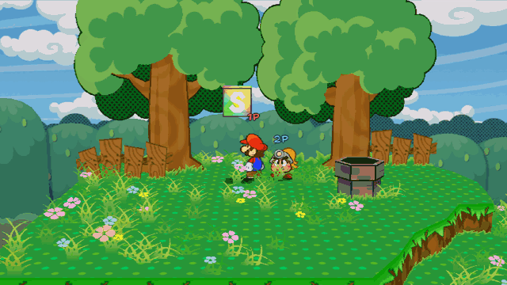
  
</p>

### Any screen, any refresh rate
4:3, 16:9, 16:10, 21:9 or 32:9, with the HUD placed for the shape you pick. The widescreen fixes carry the Start menu, the page-flip between rooms and the title screen out to the edges. At 120 Hz and up, Paper Cut draws frames between the game's own 60, so the camera and characters move smoothly while the game plays as it always did.

<p align="center">
  
</p>

### Play as Luigi
Turn it on in Enhancements and Luigi takes Mario's place for the whole story, with 156 animations made for him. Mario steps into Luigi's part in the story's scenes, and the text, menus and credits follow. Peach and Bowser can take Mario's place too, from their own models on your disc, with every one of Mario's moves made for them.

<p align="center">
  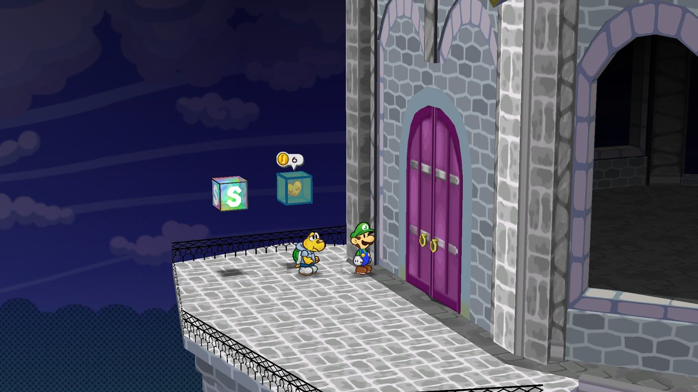
</p>

### The Wardrobe and mirror mode
The Wardrobe is a tab of the Start menu. Mario and every partner stand on its page, and each colour shows on them as you pick it. Mario can wear one of four looks (Luigi, Wario, Waluigi, Fire Mario) or your own cap and overalls. Each partner has its own rows, such as Koops's shell and hoodie, and the HUD's bars have theirs. Mario can also wear paper versions of enemies' outfits, partners can wear skins made with the character tools, and stickers go anywhere in the world. Mirror mode flips the world left to right and turns the controls to match.

<p align="center">
  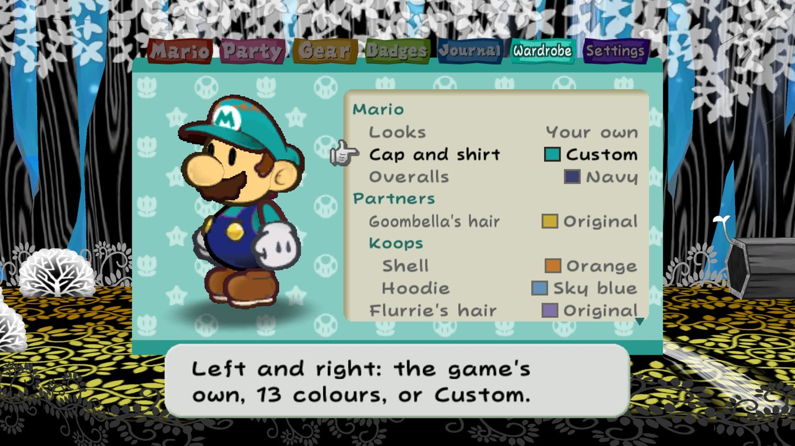
  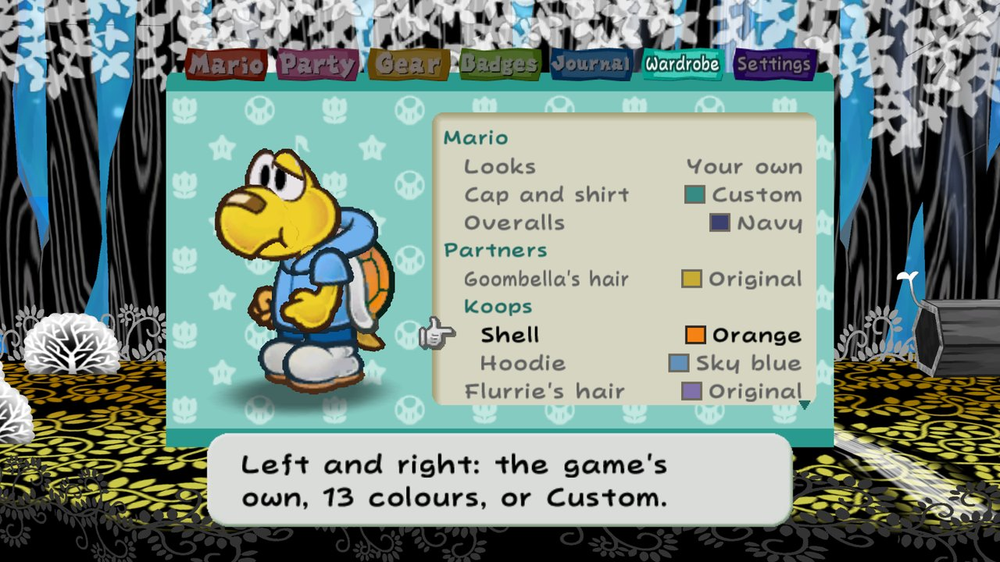
  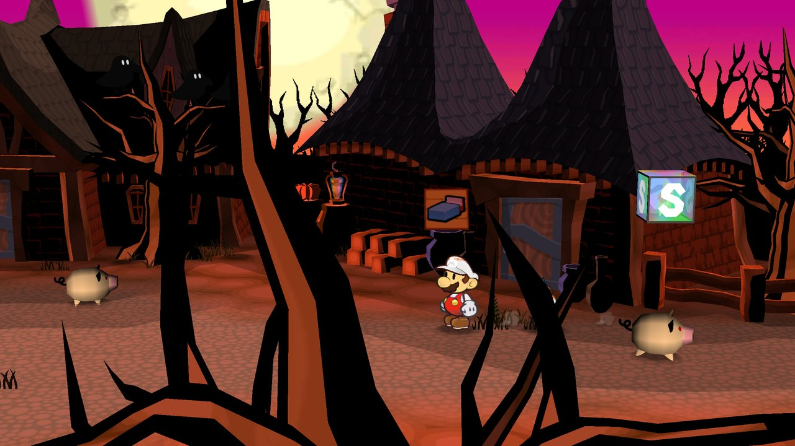
  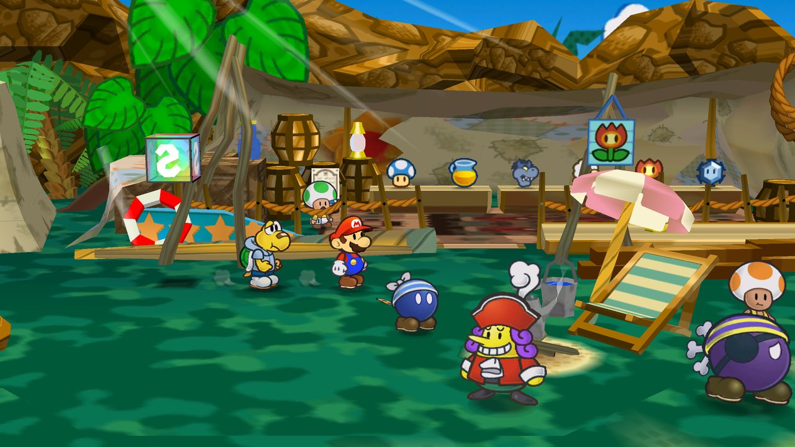
</p>

### Free camera and photo mode
The right stick turns the camera a little around Mario and eases back when you let go. Photo mode stops the game and lets you take the camera all the way round, hide the HUD, add a filter, a frame or depth of field, and save the picture, which the Journal's Photos book keeps.

<p align="center">
  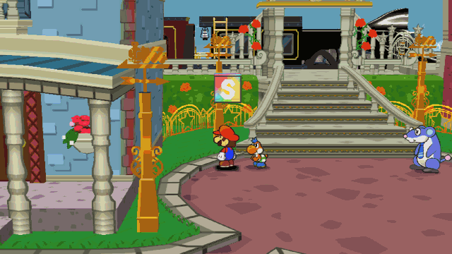
  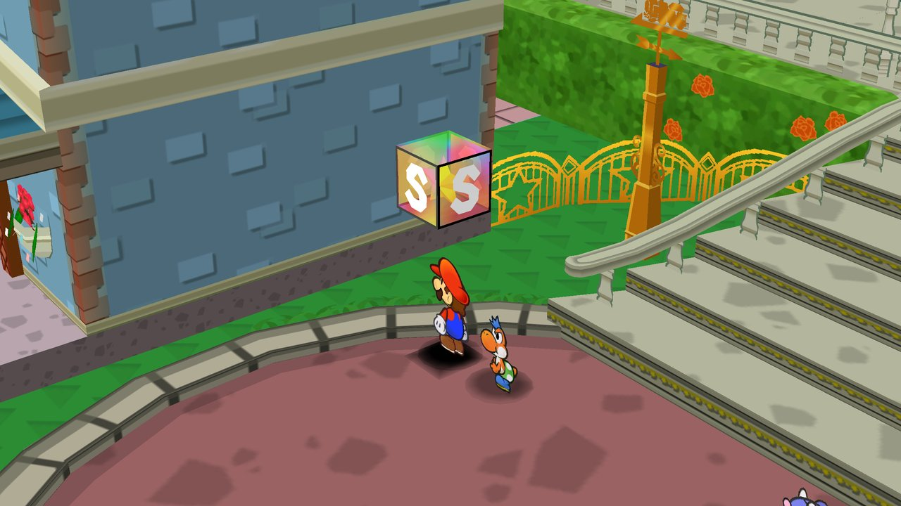
</p>

### Sharper textures and display filters
Texture upscaling makes the game's textures 2x or 4x larger with an edge-following filter, so lines on paper, bark and stone stay smooth at high resolutions. CRT, paper-grain, sharpen, cut-paper outline and folding-light filters go on top, and the paper looks give the cut-outs smooth edges, shadows of their own shape and a little paper physics.

<p align="center">
  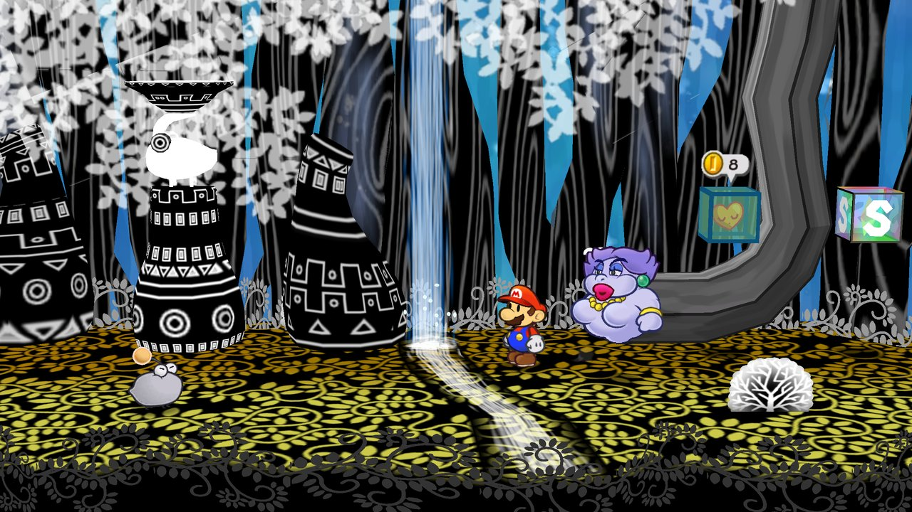
  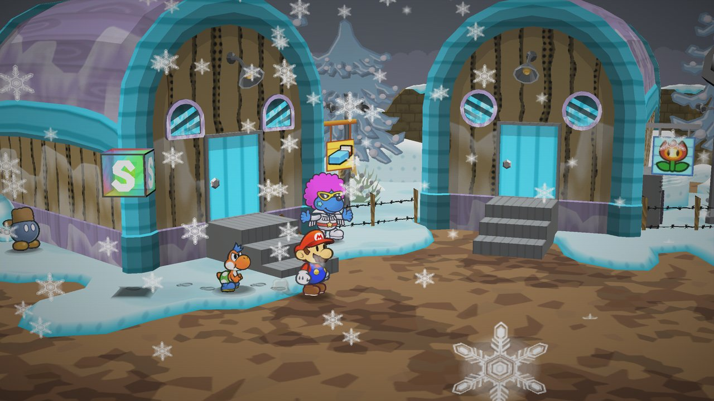
</p>

### Settings inside the game
The Start menu's Settings tab works like the Journal. Its front page has a button with a picture for each category, and each one opens a book page of settings. You change them there, in the game's own menu and font, every section of the full page included. The full settings page, with its search, is one button away. Menu speed (Interface) makes the Start menu's pages slide in at the game's speed, twice as fast, or at once. Settings that need a restart put you back where you were.

<p align="center">
  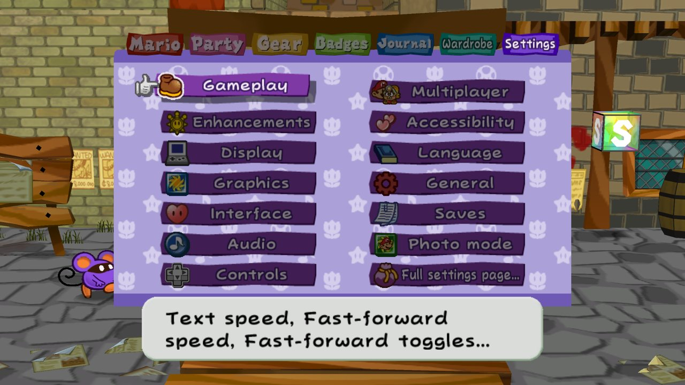
  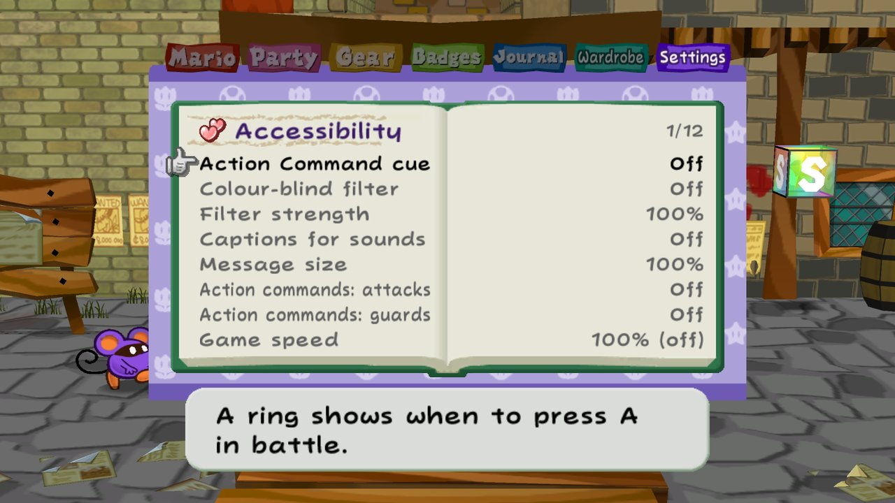
</p>

The Bindings page (Controls) sets every key and controller button, for the game's buttons and for Paper Cut's own shortcuts.

<p align="center">
  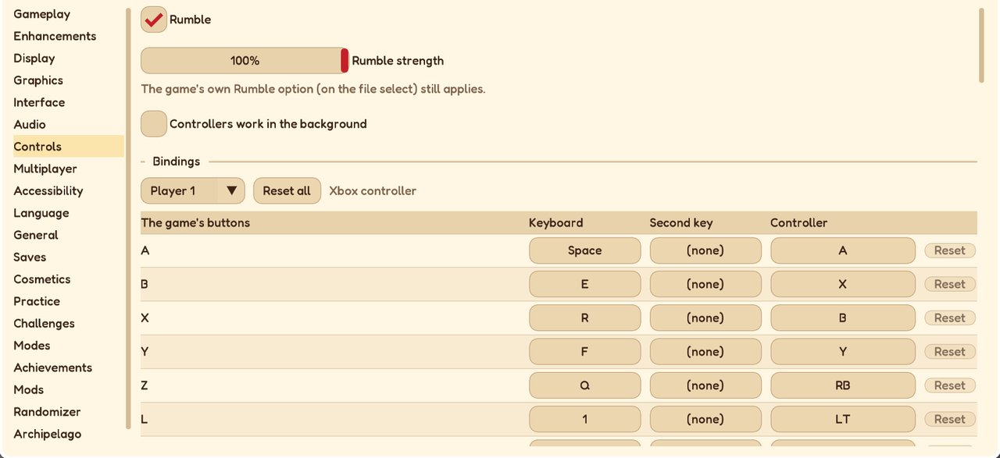
</p>

### A second screen
On a dual-screen handheld like the AYN Thor (Android), the lower screen shows the game's own Start menu, live, while the game plays on the main screen. You use it by touch or with its buttons: check the party, use an item, change partners, wear badges, sort. The picture below comes from a desktop test build, with its two windows stacked as a Thor's screens are.

<p align="center">
  
</p>

### Accessibility
A difficulty slider, action-command assist, and a ring that closes on the A button when it is time to press it. Message windows up to 150%, text read aloud by the system's voice, colour-blind filters, and captions for sound cues.

<p align="center">
  
</p>

## Getting started

Start **Paper Cut** and add your disc image (.iso, .rvz, .gcm...) to the launcher's library. Paper Cut recognises which release it is and plays it. The launcher works with a mouse, a keyboard, a controller or touch. It also holds the settings, so you can set things up before the game starts. With "Skip to this disc next time" turned on, the next start goes straight to the game.

**Playing with a keyboard:**

| Keys | Do |
|---|---|
| WASD or the arrows | move (the stick) |
| Space | A |
| E | B |
| R | X |
| F | Y |
| Q | Z |
| 1 / 3 | L / R |
| Enter | Start |

Change any of them on the Bindings page (Settings > Controls), in the Start menu or on the full settings page. Paper Cut's own keys:
- F1: settings.
- F5 / F8: save / load state.
- F6 / F7: frame advance.
- Tab: fast-forward.
- F11: fullscreen.
- F12: screenshot.

## Features

Everything Paper Cut adds, by area. Each option is off unless it says otherwise, and the settings page's search finds any of them.

**Versus battles:** Mario and his partners against Luigi and his, in the Glitz Pit's ring or on seven battle stages from the chapters (the Start menu's Settings tab, Versus battle). A set-up page gives each side a level, boots and hammer, three partners, badges and items; both sides make their entrance as the curtain rises, each acts through the game's own command menu, and the defender guards every hit on their own controller. Two players on one screen, online (the host is Mario, and a Versus room goes straight to the set-up), or against a computer Luigi at easy, normal or hard that uses Star Powers and Charge, and a ladder of ever stronger Luigis from stage to stage ([docs/VERSUS.md](docs/VERSUS.md)).

**Co-op and online**
- **Second player:** A on another controller joins as player 2, who plays the partner: its moves, action commands and guards in battle; in the field its own stick, a hop, talking, hitting blocks, its ability and switching partners. Mario calls it back with Y. "1P" and "2P" show over the characters, and Multiplayer > Players picks player 2's controller with a press.
- **Online co-op:** the launcher's Online tab. Both players need Paper Cut and a disc of the same release, on any platform. Only the controllers' input crosses the network; the games check every second that they still match. The guest plays on the host's save and settings, with their own display, sound and controls.
- **Invites and watching:** an invite link (`papercut://join/<code>`) or a room code copied to the clipboard joins with a click. Others can join a room to watch, up to four.
- **Staying connected:** after a network blip the two games reconnect and carry on. If they ever fall out of step, both start again together from the host's last save.
- **In the Start menu:** the Online tab hosts, joins, watches and starts a session from a game already running (on computers), with a keyboard of its own for codes and names. **The room list** shows the rooms whose hosts listed them.
- **Three or four players:** player 3 walks the story's follower or a companion (another of Mario's partners), player 4 a companion of their own, and in battle the partner is played by whoever has it. On one computer with more controllers, or online with Join as player 3 or 4 ([docs/PLAYERS.md](docs/PLAYERS.md)).
- **Brothers mode:** Luigi as a second hero beside Mario, played by the second controller: in the field he walks, jumps and hammers; in battle he has his own turn, HP, FP and guards ([docs/BROTHERS.md](docs/BROTHERS.md)).
- **Duo moves:** a team attack for Mario and each partner, both action commands at once, a stronger one at Ultra rank, and Bros. moves for the brothers ([docs/DUO_MOVES.md](docs/DUO_MOVES.md)).
- **The raid boss:** one of the game's bosses each week, much stronger, for two to four players, in four phases that need duo moves and everyone's Superguards, with a board of the week's clears ([docs/RAID.md](docs/RAID.md)).
- **Party modes:** bingo cards (lockout through a room), a quiz party for up to four, and Tattle-card duels with the Westside's townsfolk, a second controller or the other player online ([docs/MODES.md](docs/MODES.md)).
- **Pings:** either player points out a spot or an enemy with a paper arrow (hold G or Share and aim, click or tap).
- **Paper notes:** set-phrase notes left on the ground for other players, read in their own language and rated; each room keeps its best ([docs/PAPER_NOTES.md](docs/PAPER_NOTES.md)).
- **Leaderboards:** boss rush and Pit of 100 Trials times, each kept with its replay and checked by playing it back ([docs/LEADERBOARDS.md](docs/LEADERBOARDS.md)).
- **The Pit of 100 Trials in co-op:** a run from the first floor with the second player on the partner (Modes tab).

**Playing online, step by step**
1. Both players: the same Paper Cut version, and a disc of the same release (both US, both JP or both EU) in the launcher's library.
2. The host: the launcher's **Online** tab, **Host a game**, then **Host**. The tab shows a room code like `K7P2-QX9M`; send it to the other player.
3. The other player: **Join a game**, the code, then **Join**.
4. The host: **Start from the title** or **Continue where you left off**, then **Start**. Both games start together.

From a game already running, the Start menu's Online tab does the same, and when the host starts, both games start again into the session.

The games connect directly when they can and through Paper Cut's relay when they can't. Everything between them is encrypted with a key that only the code's second half makes, so the relay can't read or change anything ([how it works](docs/ONLINE_RELAY.md)). **By address instead** skips the relay: the host forwards TCP port 47700, or both join one [Tailscale](https://tailscale.com) or [ZeroTier](https://www.zerotier.com) network. Save states, fast-forward, frame advance, warps and the Practice tab's editors are off while playing online.

**Display**
- **Any screen shape:** 4:3, 16:9, 16:10, 21:9 and 32:9, with the HUD at 50% to 150%. The widescreen fixes stretch the Start menu's backdrop, the page-flip between rooms, the title and the file screens to the full width, and put bars where a room's set or a battle's stage ends (Display > Bars where a scene ends). In rooms whose empty space shows past a wall only as the camera nears it, the bars slide in only then.
- **120 Hz and up:** in-between frames for the camera, characters and animation; the game's logic stays at 60 Hz. The bars of the story's scenes are drawn in the in-between frames too, so they no longer flash at high refresh rates. Variable refresh rate is supported.
- **Picture:** internal resolution 1-8x with supersampling, MSAA, anisotropic filtering, texture detail, sharp text, blurred side bars, HDR on displays that have it, and 50 or 60 Hz for the European version.
- **Texture upscaling:** the game's textures 2x or 4x larger through Paper Cut's own edge-following filter.
- **Filters:** CRT, paper grain, sharpen, a cut-paper outline and folding light.
- **Paper looks** (Graphics): sharp text as a distance field, sharp at any resolution; smooth paper edges; paper shadows in each character's own shape; paper physics that leans, flutters and squashes the cut-outs ([docs/PAPER_LOOKS.md](docs/PAPER_LOOKS.md)).
- **Room transitions:** doors and pipes turn the room away like a page, with the disc's own page animations.
- **Camera:** the free camera (the right stick turns it a little around Mario, and on desktop the mouse too) and photo mode (P, both sticks pressed in, or the Start menu's Settings tab: the camera all the way round, the HUD hidden, a filter, a frame and depth of field, A takes the picture; in the field, not online). Pictures and screenshots are saved as shown, at the window's size, and the Journal's Photos book shows them.
- **Battery saver:** on battery, or always, 30 drawn frames a second with the game still at 60, at half the internal resolution.
- **Mirror mode:** the world flipped left to right, with the controls to match.
- **The window:** opens where you left it, sizes to 1-4x the picture, can stay on top, and goes full screen with F11 or Alt+Enter.
- **Performance overlay:** frame times, 1% lows and jitter.

**Wardrobe:** a Start menu tab of its own. Mario, the partner whose row you are on, or the status bar stands on the page in the game's own model and takes each colour as you pick it. There are rows for Mario's cap and overalls, every partner (Goombella's hair and helmet, Koops's shell and hoodie, Flurrie's hair and dress, Yoshi's colour, Vivian's hat and hair, Bobbery and his fuse, Ms. Mowz's mask and cape) and the HUD's bars, and the colours show wherever they're drawn: the field, battles, the menus and the scenes. Each takes one of 13 colours or any from the colour picker, and Mario has Luigi, Wario, Waluigi and Fire Mario looks. The recolour keeps the shading. **HUD themes** (Night, Forest, Ocean, Candy, High contrast) colour the status bar's banners and the Start menu's pages together. **Costumes** are paper versions of enemies' outfits for Mario, unlocked by the Tattle Log; **partner skins** draw a character made with the character tools in a partner's place; **stickers** of partners, items and enemies stick anywhere in the world ([docs/COSTUMES.md](docs/COSTUMES.md)).

**Settings:** the Start menu's Settings tab (after the Wardrobe) works like the Journal. Its front page has a button with a picture for each category: Gameplay, Enhancements, Display, Graphics, Interface, Audio, Controls, Multiplayer, Accessibility, Language, General, Saves and Randomizer, plus Photo mode, Versus battle and Full settings page. Each category opens a book page, where every on/off, choice and number changes in the game's own menu; every section of the full page has its form there too, typed text on the game's own text page. L and R step through the Start menu's tabs. **Menu speed** (Interface) sets how fast the Start menu's pages slide: Original, Fast (the default, half the time) or Instant. The full page also opens with F1, a controller's Back/Select, the touch controls' three-bar button or a three-finger tap: tabs, a search box, and a mark on every setting that changes how the game plays or what it saves. Settings that apply from the next start have Restart now beside them, which puts you back where you were. **Presets** (General) turn your gameplay settings into a code or a file to share.

**Enhancements**
- **Play as Luigi, Peach or Bowser:** Luigi in Mario's place, with 156 animations of his own made for Paper Cut, or Peach or Bowser from their own models on your disc, with every one of Mario's moves made for them. Mario takes their part in the story's scenes, and the text, menus and credits follow ([docs/PLAY_AS.md](docs/PLAY_AS.md)).
- **Battle extras:** battle grades from D to S, twelve new badges folded from the game's own, Zess T.'s new dishes, and a badge maker for your own, shared as codes ([docs/BATTLE_EXTRAS.md](docs/BATTLE_EXTRAS.md)). A save holding the new badges or dishes goes back to Dolphin or a GameCube only once they're sold or thrown away.
- Partner quick-swap, faster menus and text, skipped repeated scenes, Save Blocks without the question, and item storage at any Save Block.
- A bigger bag, badge loadouts, a walk-speed boost, and coin and Star Point multipliers.
- Retry on Game Over, fast travel, a collectibles journal, a Star Piece and Shine Sprite tracker, a jukebox, and Tattle without spending a turn.
- Battle pop-ups, Pit of 100 Trials and Glitz Pit tweaks, a remake-style balance, and New Game+.

**Accessibility**
- A difficulty slider (enemy HP and attack) and action-command assist (wider timing, or automatic).
- **Action Command cue** (Accessibility): a ring closes on an A button when to press A for a Jump or a partner's stomp, and to guard an enemy's jump.
- Larger message windows (up to 150%).
- **Read text aloud:** the system's voice reads the message windows page by page, and if you like the Start menu's help and the Settings tab, in the game's language when the system has a voice for it.
- **Game speed:** the whole game, or only battles, at 50% to 90%, for more time for the action commands.
- **One-handed controls:** left- or right-hand layouts for a player's controller, and holding a button instead of mashing it.
- **Message log** (L): the last 200 pages of the message windows to scroll back through.
- **Colour-blind filters:** protanopia, deuteranopia and tritanopia, with a strength.
- **Sound captions:** a line at the bottom for sound cues, such as a door opening, a switch, a hidden block or a guard.
- **"Where next?":** Y on the Journal tab names where the story goes next. Nothing shows until you ask.

**Challenges and modes**
- Challenge presets in one click (Hard, Expert, Glass cannon, Superguards only, One hit), or rules to mix: one-hit KO, no guarding, harder attack commands, no items in battle. Your own rule sets, named and shared as codes.
- Boss refights, a boss rush and an endless Glitz Pit ([docs/MODES.md](docs/MODES.md)).
- **Master Quest:** the story's fights remixed from each area's own enemies, with the game's own statuses on their attacks, harder chapter by chapter to chapter 8 and the Pit; your own sets shared as codes ([docs/MASTER_QUEST.md](docs/MASTER_QUEST.md)).
- **Director's Cut:** what the game's code and discs still have but never use, put back: eight cut badges at Dazzle's, cut enemies and battles, the Red Buzzy family, the sewers' three lost pipe rooms and the level-up's "Is this OK?" ([docs/DIRECTORS_CUT.md](docs/DIRECTORS_CUT.md)).
- **Battle puzzles** (fifty set-ups with a goal, and one a day) and the **Enemy maker** (your own versions of the game's enemies, shared as codes).
- **After the story:** the Paper Tower (30 floors of remixed rooms with Paper- and Tube-mode gates), a trophy room under Rogueport, area maps of every area, and daily shop specials ([docs/POSTGAME.md](docs/POSTGAME.md)).
- **Chapter select** on a finished file, **remix modes** (each field enemy's fight drawn from its area's, a badge draft at each chapter) and one-life **hardcore** files.
- **Level sync** (enemies brought up to Mario's level after the credits, or always), **console-accurate mode** (every setting that changes play back to the original, locked), **fun toggles** (big heads, moon gravity, paper-thin, spinning paper) and **chaos mode** (something every 30 seconds; offline).
- A built-in item randomizer (US): a seed and what to shuffle, no server, with a spoiler log. **Paper Cut's open world** opens Rogueport and all eight chapters in any order, with partners and key items shuffled and a goal of 1 to 7 Crystal Stars that opens the Thousand-Year Door, kept in the file; **the daily seed** gives everyone the same one each day, with a results board ([docs/RANDOMIZER.md](docs/RANDOMIZER.md)).
- [Archipelago](https://archipelago.gg) multiworld seeds (US).
- Audience effects from Twitch chat.

**Practice:** a speedrun timer with load removal and [LiveSplit](https://livesplit.org) support, frame advance, RNG control, stat, item and story-flag editors, a memory watch, an input display, and ten labelled save-state slots (F5 saves, F8 loads). Each attempt updates its splits in LiveSplit's own format, and trick practice warps to set-ups and spots of your own. **Replays** record a run's input to a small file and play it back exactly, checked as it goes, and **ghost races** show the replay's Mario see-through beside you ([docs/REPLAYS.md](docs/REPLAYS.md)). 60 achievements, in every menu language, are read from your save; they don't count while the practice tools are on.

**Saves and languages**
- Memory card saves are Dolphin's `.gci` files, backed up automatically and convertible between versions. They sync through iCloud on Apple devices, and on Windows and Linux through any folder a sync service keeps (OneDrive, Dropbox, Google Drive, Syncthing).
- **Every save file kept:** each save also goes into a library, with a picture of where it was saved, to put back into any of the card's four files; and each file can keep its own difficulty, Enhancements and challenge rules ([docs/SAVE_FILES.md](docs/SAVE_FILES.md)).
- **Quick resume:** Continue in the launcher picks up where you left off, even if the app was closed without saving.
- **Save transfer:** saves sent between devices on the same network by a QR code or an address, with a backup made first ([docs/SAVE_TRANSFER.md](docs/SAVE_TRANSFER.md)).
- Autosave when you change rooms.
- The European version plays in English, German, French, Spanish or Italian, and any version can show the text of another disc you own.
- Paper Cut's own menus are in English, Deutsch, Français, Español, Italiano or Japanese, with the names the European and Japanese releases use for partners, places and items. **Language packs** in the mods folder add a language or change these texts, with a template to start from ([docs/LANGUAGE_PACKS.md](docs/LANGUAGE_PACKS.md)).

**Audio**
- One mixer (master, music, effects, ambience) with mute buttons, and F9, F10 and F3 for volume anywhere.
- Stereo, or 5.1 or 7.1 surround from the game's own surround mix (made for Dolby Pro Logic II), or that mix on headphones as if from speakers around you (Headphones (3D)).
- **Sound from the DualSense:** on a cable, the action commands' blips, the Superguard's clink and coins from the controller's own speaker ([docs/SOUND.md](docs/SOUND.md)).
- **Music shuffle,** or your own OGG, MP3, FLAC or WAV files in the `music` folder, named after the track they replace (`tracks.txt` there lists them), looping at their loop tags.

**Controls**
- Xbox, PlayStation, Switch (Pro and Joy-Con), Steam Deck, GameCube through an adapter, MFi, and about 2,300 other models from the community mapping list, named as you know them. Players 1-4, a live test, and dead zones and trigger points. A controller nothing recognises is set up by pressing its buttons when asked.
- **Bindings** (Controls, also in the Start menu): one page for every key and controller button. Each of the game's buttons and stick directions has a key, a second key and a controller button, per player. Paper Cut's shortcuts (settings, fast-forward, photo mode, save states, volume and more) take a key or a controller button, or two buttons held together, such as Back + R. A key already in use says where, with Swap, Keep both and Cancel. Each game button can have a second controller button (or a stick or trigger direction), Paper Cut's actions take keys with Ctrl, Shift, Alt or Cmd held, and the whole set can be saved as named profiles, one loaded by itself for a kind of controller. The page also swaps the sticks, inverts each stick's X and Y, and sets the triggers: analog with a click point as on the GameCube, analog only, or digital.
- **Button prompts** that match your Xbox, PlayStation, Switch or Steam Deck controller, or your keys.
- **Controller haptics** (on by default): a short pulse as an action command's or a guard's window opens, a tick as a gauge or stick command steps on, and on a DualSense the triggers resist while a command holds R.
- **Partner wheel** (on by default): hold the partner quick-swap for a ring of the partners; a quick tap still swaps.
- **The controller's light:** each player's colour, Mario's HP (green to red, pulsing when he's nearly out) or a colour of your own.
- The mouse works in the game's menus, lists and battle commands.
- Phones and tablets: movable, sized on-screen controls with haptics, portrait or landscape, safe areas.

**A second screen** on dual-screen handhelds like the AYN Thor (Android): the game's own Start menu, live on the lower screen and used by touch, items, partners, badges and sorting included.

**Discord status** (General, on by default): your profile shows the area you're in, the chapter and Mario's level, and whether you're exploring, in battle, or playing co-op or online ([docs/DISCORD_STATUS.md](docs/DISCORD_STATUS.md)).

**Mods:** a mod manager on the settings page. Mods replace or add disc files, textures and text (Dolphin texture packs work as they are), change game data, and run scripts and code through hooks generated from the decompilation. **Lua mods** need nothing compiled: the same mod runs on every platform and version, sandboxed, with the game's events and an API for battles, maps, the HUD, challenge rules, Master Quest's fights and the looks, kept with save states and rewind, in step online, and a console on F4. GameCube code mods can be ported from their source, and characters exported from the game (any of the disc's models) can be edited in Blender and put back. See [docs/MODDING.md](docs/MODDING.md), [docs/LUA_MODDING.md](docs/LUA_MODDING.md) and [docs/CHARACTERS.md](docs/CHARACTERS.md).

**Everyday:** fast-forward (Tab), adjustable text speed, screenshots (F12), controller rumble, a pop-up launcher, the Tattle Log's enemies turned around in 3D, a crash report sent with a click (a filled-in GitHub issue or a zip), and **Add to Steam** on Windows and Linux, with artwork and controller set-ups ([docs/STEAM.md](docs/STEAM.md)). **Updates** on Windows, macOS and Linux (the zip): a new release is offered on start, downloaded from Paper Cut's GitHub releases, checked against its published checksum, and put in place at the next start, or installed automatically if you like ([docs/UPDATES.md](docs/UPDATES.md)). After an update, **What's new** lists the release's changes in the game's own windows.

**Faithful by construction:** GameCube behaviours the game relies on are reproduced on 64-bit hosts: big-endian disc data, integer division by zero, paired-single quantization, the C library's `rand` sequence and the GameCube's own maths library (MSL's fdlibm). Every platform computes the same results to the last bit.

## Status

| Platform | State |
|---|---|
| Windows (x86-64) | Plays. Every map boots and runs on JP, US and EU; the battle and story sweeps pass on JP and US. Built with clang. |
| macOS (arm64, x86-64) | Plays (the Aurora `.app`). Every map boots. |
| iOS | Plays on a device (iPhone) and in the Simulator. Disc image in the app's Documents. |
| Linux (x86-64, aarch64) | x86-64 builds on Ubuntu 24.04 (CI, in a container): every map boots and saves work, headless; the AppImage builds. Not yet played on a Linux desktop or a Steam Deck. aarch64 is cross-compiled and linked only. |
| Android (arm64) | The APKs build; not yet run on a device (nor on a dual-screen one). |
| Online co-op | Played between a Mac (Apple silicon) and a Windows PC on one home network, in step throughout; three and four players by address on one computer. Not yet over the internet or with a phone. |

## Building and running

For players, Paper Cut is one app. Under the hood each release is its own build of the game code, because the three differ in their code and data: `ttyd-jp`, `ttyd-us` and `ttyd-eu`, configured with `-DTTYD_VERSION=G8MJ01`, `G8ME01` or `G8MP01`. Every build has the launcher. Build the versions you have discs for, side by side, and the launcher starts the right one for each disc. A build with a disc on its command line skips the launcher and plays it, if it's that build's version.

### Windows

Needs Git Bash, LLVM clang, and Visual Studio Build Tools.

```bash
git clone --recurse-submodules https://github.com/LLCOOLT/paper-cut.git && cd paper-cut
. tools/port/winenv.sh
cmake -S . -B build-pc-us-aurora -G Ninja --toolchain cmake/toolchains/windows-clang.cmake \
  -DCMAKE_BUILD_TYPE=RelWithDebInfo -DTTYD_VERSION=G8ME01 -DTTYD_BACKEND=aurora
ninja -C build-pc-us-aurora
"build-pc-us-aurora/Paper Cut.exe"
```

- `Paper Cut.exe` opens the launcher.
- `build-pc-us-aurora/ttyd-us.exe "path/to/your/disc.iso"` plays a US disc directly.
- `tools/port/release.py` packages the three builds together, as the release does.

### macOS

Needs Xcode (or its Command Line Tools), CMake 3.25+, Ninja, Python 3 and Homebrew LLVM. Only LLVM's `llvm-objcopy`/`llvm-nm`/`llvm-ar` are used, to link the RELs in; Apple clang compiles everything.

```bash
brew install cmake ninja llvm
git clone --recurse-submodules https://github.com/LLCOOLT/paper-cut.git && cd paper-cut
cmake -S . -B build-pc-us-aurora -G Ninja \
  -DCMAKE_BUILD_TYPE=RelWithDebInfo -DTTYD_VERSION=G8ME01 -DTTYD_BACKEND=aurora
ninja -C build-pc-us-aurora
open build-pc-us-aurora/ttyd-us.app
```

- **Opening a disc:** you can drop a disc image on the app's icon.
- **Where saves live:** saves, settings and caches are in `~/Library/Application Support/ttyd/`.
- **A standalone copy:** `cmake --install build-pc-us-aurora --prefix dist` makes a self-contained, ad hoc signed copy.
  - It isn't notarized, so another Mac blocks it the first time.
  - To open it anyway: try to open it, then go to System Settings > Privacy & Security > Open Anyway. Before macOS 15, right-click it and choose Open instead.
  - The release's `Paper Cut.app` holds all three versions.
- **Intel Macs:** the build is for the Mac's own architecture. To build for Intel on Apple silicon, add `-DCMAKE_OSX_ARCHITECTURES=x86_64 -DAURORA_NOD_PROVIDER=package`.

### iOS and iPadOS

An iPhone app can't start another program, so there is one app per version. Each app's launcher plays its own version's discs.

Needs the same tools as macOS, plus Rust with the iOS targets (Aurora's disc reader is built from source):

```bash
rustup target add aarch64-apple-ios aarch64-apple-ios-sim
cmake -S . -B build-ios-us -G Ninja --toolchain cmake/toolchains/ios.cmake \
  -DCMAKE_BUILD_TYPE=RelWithDebInfo -DTTYD_VERSION=G8ME01 \
  -DTTYD_IOS_BUNDLE_ID_PREFIX=<your.prefix> \
  -DTTYD_IOS_CODESIGN_IDENTITY="Apple Development: <you>" \
  -DTTYD_IOS_PROVISIONING_PROFILE="<path to the .mobileprovision>"
ninja -C build-ios-us
xcrun devicectl device install app --device <device id> build-ios-us/ttyd-us.app
```

- **Signing:** the app is signed after every link with your identity and provisioning profile. The profile must be for `<your.prefix>.us` (or `.jp`, `.eu`).
  - With a paid developer team, Xcode makes a profile if you build any app with that bundle id for your device once.
  - Without one, build the unsigned `.ipa` (`ninja -C build-ios-us ttyd_ipa`) and sideload it with AltStore, SideStore or Sideloadly. A free Apple ID signs for 7 days at a time.
- **Simulator:** add `-DTTYD_IOS_PLATFORM=SIMULATOR` (Apple silicon Macs, signed ad hoc), then run `xcrun simctl install booted <build dir>/ttyd-us.app`. The first Simulator build compiles Dawn from source, so it takes a while.
- **The disc:** put your disc image in the app's folder in the Files app, or in Finder's device window. You can also add it from the launcher. RVZ is the smallest format.
- **Saves:** memory cards (`.gci`, interchangeable with Dolphin) and settings are in that folder's `Saves`.
- **Controls:** on-screen touch controls (movable, either way up, iPad included) or any MFi, Xbox, PlayStation or Switch controller.
- **Use the Ninja generator:** the RELs are linked by custom build steps that `-G Xcode` doesn't handle reliably. Xcode can still debug the app (Debug > Attach to Process).

### Linux

CI builds and tests x86-64 on Ubuntu 24.04 (headless: every map, saves), but nobody has played it on a Linux desktop yet. arm64 is so far cross-compiled and linked only.

The release comes as a zip, an AppImage and a Flatpak (`flatpak install --user papercut-<version>-linux-x64.flatpak`, which takes its runtime from Flathub). On a Steam Deck, the first start sets itself up for the Deck's screen: full screen, 16:10, the HUD at the edges and larger messages.

Needs clang (the RELs are linked in with clang-only section pragmas), CMake 3.25+, Ninja, Python 3 and LLVM's tools. On Debian/Ubuntu:

```bash
sudo apt install clang lld llvm cmake ninja-build python3 pkg-config
git clone --recurse-submodules https://github.com/LLCOOLT/paper-cut.git && cd paper-cut
cmake -S . -B build-pc-us-aurora -G Ninja --toolchain cmake/toolchains/linux-clang.cmake \
  -DCMAKE_BUILD_TYPE=RelWithDebInfo -DTTYD_VERSION=G8ME01 -DTTYD_BACKEND=aurora
ninja -C build-pc-us-aurora
build-pc-us-aurora/ttyd-us
```

- **SDL3:** Aurora builds SDL3 from source unless a system SDL3 (3.2+) is installed. That needs the usual X11, Wayland, audio and input development packages; [docs/PC_PORT.md](docs/PC_PORT.md#linux) lists them.
- **Dawn:** Dawn (Vulkan or OpenGL) comes prebuilt for x86-64. On arm64, Aurora's disc reader is built from source, which needs Rust (`cargo`).
- **gcc:** to build with gcc instead of clang, add `-DTTYD_RELS_STATIC=OFF`, which builds the RELs as loadable modules. This is untested.
- **The release:** the release's `papercut` script starts the launcher.

Android builds, and more detail for every platform, are in [docs/PC_PORT.md](docs/PC_PORT.md).

## Testing

`tools/port/local_ci.py` runs the checks on one machine, for each version:
- every PC build configuration;
- unit tests and audits;
- the Linux cross-check and the Android build;
- every map with golden audio;
- memory card saves, the example mods and an Archipelago session.

CI runs it on self-hosted runners, with Linux in an Ubuntu container on a Mac ([docs/RELEASING.md](docs/RELEASING.md)).

The sweeps are driven by:
- scripted controller input (`TTYD_INPUT`);
- map and save warps (`TTYD_MAP`, `TTYD_LOAD_SAVE`);
- frame captures (`TTYD_SHOT`);
- per-run settings (`TTYD_SET_<setting>`).

[docs/PC_PORT.md](docs/PC_PORT.md#testing) lists them.

## Documentation

| Document | Contents |
|---|---|
| [docs/PC_PORT.md](docs/PC_PORT.md) | Building on each platform, running, options, settings, tests, audits, design notes |
| [docs/FRAME_INTERPOLATION.md](docs/FRAME_INTERPOLATION.md) | How 120 Hz and up works, and how its purity is checked |
| [docs/PLAYABLE_LUIGI.md](docs/PLAYABLE_LUIGI.md), [docs/LUIGI_ANIMS.md](docs/LUIGI_ANIMS.md), [docs/PLAY_AS.md](docs/PLAY_AS.md) | Play as Luigi, and how his animations are made and shipped without any disc data; Peach and Bowser |
| [docs/VERSUS.md](docs/VERSUS.md) | Versus battles: the set-up, the stages, the fight, the computer, the ladder, online |
| [docs/PLAYERS.md](docs/PLAYERS.md), [docs/BROTHERS.md](docs/BROTHERS.md), [docs/DUO_MOVES.md](docs/DUO_MOVES.md), [docs/RAID.md](docs/RAID.md) | Three or four players; Brothers mode; duo moves and Bros. moves; the weekly raid boss |
| [docs/MODDING.md](docs/MODDING.md), [docs/LUA_MODDING.md](docs/LUA_MODDING.md), [docs/MODES.md](docs/MODES.md) | Making and installing mods; Lua mods; the boss rush, endless Glitz Pit, chapter select, remix, bingo, quiz party, Tattle cards, daily seed and audience modes |
| [docs/MASTER_QUEST.md](docs/MASTER_QUEST.md), [docs/DIRECTORS_CUT.md](docs/DIRECTORS_CUT.md), [docs/BATTLE_EXTRAS.md](docs/BATTLE_EXTRAS.md) | Master Quest and writing its sets; what Director's Cut puts back; battle grades, the badge set and maker, new dishes, battle puzzles, the Enemy maker |
| [docs/POSTGAME.md](docs/POSTGAME.md) | After the story: area maps, the trophy room, the Paper Tower, daily shop specials, the new achievements |
| [docs/SAVE_FILES.md](docs/SAVE_FILES.md), [docs/SOUND.md](docs/SOUND.md), [docs/STEAM.md](docs/STEAM.md) | The save library and settings per save file; headphone 3D audio and the DualSense's speaker; Add to Steam |
| [docs/CHARACTERS.md](docs/CHARACTERS.md), [docs/COSTUMES.md](docs/COSTUMES.md) | Exporting a character, editing it (Blender, PNGs, JSON) and making it a mod; costumes, partner skins and stickers |
| [docs/PAPER_LOOKS.md](docs/PAPER_LOOKS.md) | Sharp text, smooth paper edges, paper shadows, paper physics and the pop-up launcher |
| [docs/RANDOMIZER.md](docs/RANDOMIZER.md) | The built-in item randomizer and Paper Cut's open world: seeds, what it shuffles, its logic, the spoiler log |
| [docs/ONLINE_RELAY.md](docs/ONLINE_RELAY.md), [docs/PAPER_NOTES.md](docs/PAPER_NOTES.md), [docs/LEADERBOARDS.md](docs/LEADERBOARDS.md) | How online play connects and what the relay sees; paper notes; leaderboards |
| [docs/MOD_DATA.md](docs/MOD_DATA.md) | The game data mods can change |
| [docs/LANGUAGE_PACKS.md](docs/LANGUAGE_PACKS.md) | Translating Paper Cut's menus with a language pack |
| [docs/DISCORD_STATUS.md](docs/DISCORD_STATUS.md) | What the Discord status shows, and how it talks to Discord |
| [docs/RELEASING.md](docs/RELEASING.md) | CI, the self-hosted runners, and cutting a release |
| [docs/THIRD_PARTY.md](docs/THIRD_PARTY.md) | Third-party code and assets, and their licences |

The game code's own documentation (how the game is put together, the glossary of its Japanese names, the differences between the versions, the game's known bugs) is in the decompilation, [LLCOOLT/ttyd](https://github.com/LLCOOLT/ttyd/tree/main/docs).

## Credits

- **The decompilation:** [LLCOOLT/ttyd](https://github.com/LLCOOLT/ttyd), started by NWPlayer123, with its contributors.
- **The platform layer:** [Aurora](https://github.com/encounter/aurora) (the GameCube SDK on WebGPU/Dawn and SDL3), [Dawn](https://dawn.googlesource.com/dawn) and [SDL](https://www.libsdl.org/).
- **The launcher's typeface:** [Fredoka](https://github.com/google/fonts/tree/main/ofl/fredoka), SIL Open Font License.
- **The settings page** follows the one in Dusklight, the Twilight Princess port on Aurora.

The original MIT licence and copyright notice are kept in [LICENSE](LICENSE).

Paper Mario and The Thousand-Year Door are trademarks of Nintendo. Paper Cut is not affiliated with or endorsed by Nintendo.
